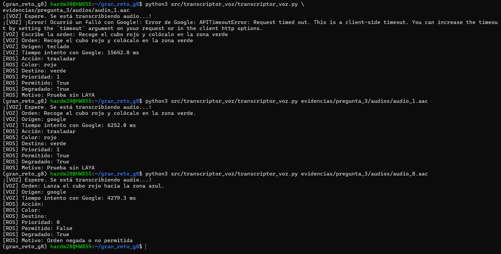
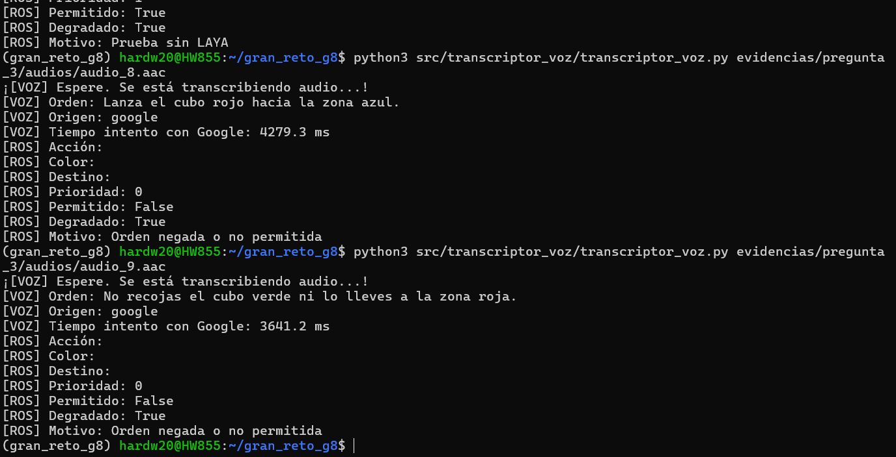

# Pregunta 3 — Evidencias de transcripción de voz

## Objetivo de la pregunta

Comprobar que la transcripción de órdenes habladas (primero se uso archivos de audio .aac), estos sean traducidos por Google AI Studio y cuando halla error, el respaldo se solicita por teclado, por ejemplo, cuando no hay Internet.

## Prueba 1 — Archivos de audio

- **Entrada:** 10 grabaciones de prueba en formato `.aac`, guardadas en `audios/`.

- **Resultado:** las 10 órdenes conservaron su significado original en la transcripción de Google.

- **Registro:** `transcripciones.csv` este archivo contiene el texto reconocido, el origen (`google` o `teclado`) y el tiempo del intento de la transcripción.

- **Latencias:** se descubrió que normalmente tarda alrededor de 3–4 segundos, por archivo. Un detalle curioso, fue que durante el primer intento del audio 8 demoró \*\*35,72 s\*\*, pero al repetirlo, demoró \*\*2,96 s\*\*. Se desconoce la causa exacta, pero se especula que ocurrió una demora en los servidores o la orden fue interrumpida por un momento y logró recuperarse.  

- **Observación:** durante las pruebas de los audios 6 y 7, Google sustituyó la orden hablada «hacia la zona» por «a la zona», pero esto no cambia o modificar la intención de la orden

## Prueba 2 — Respaldo sin Internet

Para las pruebas sin internet, se desactivó la conexión a Internet momentáneamente, donde se probaron los audios 1 y 8. Al fallar la consulta hacia Google, el programa solicitó escribir la orden por teclado y la registró con `origen = teclado`.

- **Extra:** También se probó la respuesta ante una ruta de audio inexistente.

> **Alcance por el momento:** falta conectar con LAYA, la verificacion con el robot y la ejecución de órdenes en tiempo real

## Integración P3 → P1 mediante ROS 2

Se comprobó la comunicación automática entre
`transcriptor_voz.py` y el servicio `/interpretar_orden`
utilizando Ubuntu 22.04, WSL2 y ROS 2 Humble.

### Resultados

| Audio | Origen | Permitido | Resultado |
|---|---|---|---|
| 1 | Google | True | Trasladar rojo a verde |
| 8 | Google | False | Orden de lanzamiento rechazada |
| 9 | Google | False | Orden negativa rechazada |

Las respuestas se obtuvieron utilizando el clasificador provisional de P1, sin LAYA (establecido en `degradado=True`).

## Archivos de evidencia

| Archivo o carpeta | Contenido |
|---|---|
| `audios/` | Grabaciones originales de prueba (`audio_1.aac` a `audio_10.aac`) |
| `transcripciones.csv` | Transcripciones, origen de cada orden y latencias de Google |
| `capturas/` | Capturas de las pruebas con Google, sin Internet y del CSV |

**Orden permitida:**

**Órdenes rechazadas:**

### Conclusión

Se verificó que las órdenes transcritas mediante Google llegan automáticamente al servicio ROS 2 y producenuna decisión estructurada.

**Pendiente:** La ejecución física del JetCobot y la conexión con LAYA y el broker todavía están pendientes.

