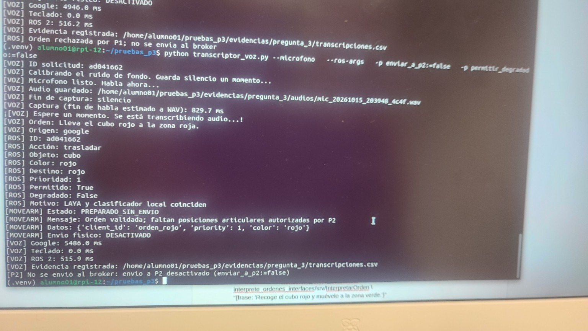
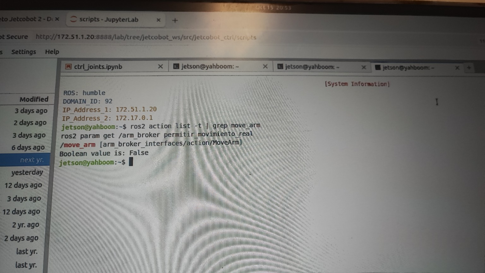

# Informe técnico de avances y pruebas — Integración P1–P2–P3

**Gran Reto JetCobot · Grupo 8** · Sesión de laboratorio del **15 de octubre de 2026** (registros y capturas de la sesión).
Documento de cierre de jornada y continuidad técnica. **Estado: integración lógica validada; ejecución física pendiente.**

Original en Word: [`Informe_Avances_JetCobot_P1_P2_P3_15Oct2026.docx`](Informe_Avances_JetCobot_P1_P2_P3_15Oct2026.docx). Los comandos usados están en [`comandos_sesion_15oct.md`](comandos_sesion_15oct.md). Las capturas citadas están en [`capturas/`](capturas/); solo se incluyen las que respaldan una afirmación de este informe.

## 1. Resumen ejecutivo

Durante la sesión se validó el reconocimiento de órdenes por micrófono en Raspberry Pi, su transcripción con Google GenAI, la interpretación por P1 con el servidor LAYA del laboratorio y la preparación de una solicitud compatible a nivel lógico con P2. También se comprobó la disponibilidad de la acción ROS 2 `/move_arm` en el Jetson y se terminó con un broker P2 ejecutándose con el movimiento físico desactivado. **No se realizó una recogida ni un traslado físico del cubo.**

| Resultado | Estado comprobado |
|---|---|
| Captura de voz y transcripción | Validado con micrófono; frase rojo→rojo reconocida |
| P1 y LAYA | Autorización no degradada comprobada |
| Preparación de orden MoveArm | Validada sin envío físico |
| Descubrimiento de P2 | Acción `/move_arm` visible; broker final en modo seguro |
| Movimiento real del JetCobot | No ejecutado; existen bloqueos técnicos deliberados |

## 2. Arquitectura y equipos

| Componente | Equipo / dirección | Función |
|---|---|---|
| P3 | Raspberry Pi `rpi-12`; 172.51.1.23 | Micrófono, Google GenAI, cliente de interpretación, adaptador P2 |
| P1 | Servicio ROS 2 en Raspberry; LAYA en PC de laboratorio 172.51.1.27:8000 | Interpretar, validar y autorizar órdenes |
| P2 | Jetson `yahboom`; 172.51.1.20 | Broker ROS 2 `/move_arm` y control del brazo |
| ROS 2 | Humble; `ROS_DOMAIN_ID=92`; discovery 172.51.1.20:11811 | Comunicación entre equipos |

Interfaz P2 observada: `arm_broker_interfaces/action/MoveArm`; campos de objetivo `joint_positions` (6 valores en radianes), `client_id` y `priority`. La disponibilidad de la acción no equivale a validación de trayectoria física (captura [`p2_02`](capturas/p2_02_jetson_brokers_fisicos_y_acciones.jpg)).

## 3. Actividades realizadas y evidencia

### 3.1 Actualización del código P1

- Se respaldó `~/pruebas_p1/interprete_ordenes_prueba.py` en `~/respaldos_p1/interprete_ordenes_prueba_antes_actualizacion.py`.
- Se clonó el repositorio del Grupo 8 en `~/gran_reto_g8_actualizado`. El último commit descargado fue `ca846f6` (merge de la corrección de P1).
- Se verificó la sintaxis de `interprete_ordenes.py` con `python -m py_compile`: sin errores.
- La primera compilación `colcon` reconoció únicamente `interprete_ordenes_interfaces`: el directorio de código `interprete_ordenes` no contenía `setup.py`/`package.xml` y no era un paquete instalable tal como estaba.
- Posteriormente se comprobó un nodo nuevo `/interprete_p1_actualizado` y su servicio `/interpretar_orden_p1_actualizado`. El registro no documenta todos los pasos intermedios para iniciarlo; por eso no se atribuye una instalación reproducible que no se haya mostrado.
- El P3 usado en las pruebas finales tenía configurado el servicio `/interpretar_orden_p1_actualizado`, verificado con `grep` sobre `transcriptor_voz.py` (capturas [`p3_06`](capturas/p3_06_broker_p2_no_disponible.jpg)).

### 3.2 Diagnóstico y recuperación de LAYA

- El primer llamado al P1 actualizado devolvió `permitido=True` pero `degradado=True`, porque la URL predeterminada `http://127.0.0.1:8765` rechazaba la conexión. No había servidor local en el puerto 8765 ([`p1_01`](capturas/p1_01_laya_url_localhost_y_timeout_ip_13.jpg)).
- La IP 172.51.1.13:8000 resultó inaccesible desde la Raspberry (*Destination Host Unreachable* / *No route to host*) ([`p1_01`](capturas/p1_01_laya_url_localhost_y_timeout_ip_13.jpg) muestra el tiempo agotado; la captura con *No route to host* no se incluye porque mostraba direcciones MAC de los equipos).
- Se identificó la PC real del laboratorio en 172.51.1.27, con conectividad por `ping` y TCP al puerto 8000. El servidor Uvicorn estaba activo: `GET /` devolvió HTTP 404 y `GET /v1/systemone` devolvió HTTP 405 con `Allow: POST`. Esas respuestas confirmaron la disponibilidad del servidor y de la ruta, no un error del servicio ([`p1_03`](capturas/p1_03_laya_pc_172_51_1_27_http_404_405.jpg)).
- Corrección aplicada: `ros2 param set /interprete_p1_actualizado laya_url http://172.51.1.27:8000`.
- Tras corregir la URL, la llamada con «Recoge el cubo rojo y muevelo a la zona verde» devolvió `accion=trasladar`, `color=rojo`, `destino=verde`, `prioridad=1`, `permitido=True`, `degradado=False` y `tiempo_servidor_ms≈495.44`. El motivo señaló una discrepancia de destino de LAYA corregida por el clasificador local.

### 3.3 Google GenAI y micrófono (P3)

- Se detectó la cámara Logitech Brio 100 como dispositivo de captura de audio en la Raspberry (tarjeta ALSA B100). Un intento de captura sin voz detectada en 8 s cambió a teclado ([`p3_03`](capturas/p3_03_microfono_sin_voz_teclado_veto_p1.jpg)). Más tarde el micrófono grabó correctamente archivos WAV y la transcripción funcionó.
- En una ejecución Google devolvió «No se pudo encontrar la API key»; se corrigió la disponibilidad de `GEMINI_API_KEY` en la sesión de terminal y la siguiente prueba transcribió correctamente. El valor de la clave no se registra.
- **Audio pregrabado:** «Recoge el cubo rojo y muévelo a la zona verde». Google transcribió, P1 permitió sin degradación y el adaptador P3 rechazó preparar movimiento por «Destino incompatible con P2». Es coherente con la limitación de P2: el depósito admitido actualmente es la zona del mismo color ([`p3_02`](capturas/p3_02_audio_pregrabado_destino_incompatible.jpg)).
- **Micrófono (exitosa):** «Recoge el cubo rojo y llévalo a la zona roja». Google transcribió; P1 autorizó con `permitido=True` y `degradado=False`; el adaptador produjo `PREPARADO_SIN_ENVIO` con `client_id=orden_rojo`, `priority=1`, `color=rojo`. **No se envió ninguna meta al broker** ([`p3_01`](capturas/p3_01_microfono_google_laya_preparado_sin_envio.jpg)).
- El adaptador también preparó, sin envío, las órdenes rojo→rojo, verde→verde, azul→azul y amarillo→amarillo ([`p3_04`](capturas/p3_04_adaptador_cuatro_colores_sin_envio.jpg)).

### 3.4 Tiempos de la prueba con micrófono

| Medición | Valor registrado |
|---|---|
| Captura (fin de habla estimado a WAV) | 1005.1 ms en una prueba; 829.7 ms en la prueba posterior |
| Google GenAI, prueba posterior | 5486.0 ms |
| Teclado, prueba posterior | 0.0 ms |
| ROS 2, prueba posterior | 515.9 ms |

Los tiempos proceden de salidas de terminal, no de un estudio de latencia repetido ni de promedios estadísticos.

### 3.5 Comunicación P3–P2

Se creó y ejecutó `conexion_p3_p2.py` desde la Raspberry. La comprobación informó **CONEXION CORRECTA**, acción `/move_arm`, interfaz `MoveArm`, ningún objetivo enviado y movimiento físico desactivado ([`p3_05`](capturas/p3_05_conexion_p3_p2_correcta.jpg)). Se guardó un registro de cierre en `evidencias/pregunta_3/cierre/integracion_p1_p2_p3.txt` ([`p3_07`](capturas/p3_07_registro_cierre_integracion.jpg)).

Hubo un momento en que el cliente informó «Broker P2 no disponible» ([`p3_06`](capturas/p3_06_broker_p2_no_disponible.jpg)); al restaurar el entorno ROS 2, el discovery server y los overlays, la acción volvió a aparecer y la prueba fue exitosa. Este resultado corresponde a disponibilidad del servicio, no a una acción completada.

## 4. Incidencias detectadas y tratamiento

| Incidencia | Diagnóstico / solución | Estado |
|---|---|---|
| P1 antiguo rechazaba una frase válida | El proceso `interprete_ordenes_prueba.py` contenía el veto antiguo; se levantó el servicio actualizado y P3 se orientó a él | Resuelto en prueba |
| P1 no compilaba como paquete ROS 2 | Faltaba manifiesto/`setup` en el directorio esperado; `colcon` solo compiló interfaces. Se usó un servicio actualizado verificable | Funcional; empaquetado por documentar |
| LAYA degradado por localhost | No había servidor en 127.0.0.1:8765; se actualizó `laya_url` a 172.51.1.27:8000 | Resuelto en sesión |
| IP de LAYA incorrecta | 172.51.1.13 no era alcanzable; se comprobó la PC en 172.51.1.27 | Resuelto |
| GET del endpoint devolvía 405 | La ruta `/v1/systemone` exige POST; no era una caída del servidor | Aclarado |
| Google sin API key | La variable `GEMINI_API_KEY` no estaba disponible; tras configurarla hubo transcripción correcta | Resuelto en sesión |
| Ruido / ausencia de voz | Primeras capturas fallidas; después se obtuvieron WAV y frases válidas | Mitigado; ambiente ruidoso |
| Destino rojo→verde incompatible con P2 | P1 puede autorizarlo, pero el adaptador bloquea el envío por la capacidad actual de P2 | Bloqueo correcto |
| Conexión intermitente a P2 | Se verificaron entorno ROS 2, dominio, discovery y disponibilidad de `/move_arm` | Conexión recuperada |
| Jetson equivocado / procesos duplicados | Se identificó otro Jetson; luego se accedió al correcto y se detuvieron brokers duplicados | Resuelto en equipo correcto |
| Cámara `/dev/video0` ocupada | En el Jetson equivocado, un proceso broker tenía abierta la cámara | Diagnóstico; no extrapolar al correcto |
| Puerto físico mal identificado | En el Jetson correcto se observó `/dev/ttyUSB0`; `/dev/ttyUSB1` no existía | Puerto identificado |
| Recogida física bloqueada | `mover_agarre()` lanza `RuntimeError` hasta validar la aproximación con MoveIt2 | Pendiente de P2 |

## 5. Diagnóstico en el Jetson correcto

Al cambiar al Jetson correcto se identificaron los procesos del broker físico (PID 1744249 y 1744272), iniciados con `permitir_movimiento_real:=true`, y un proceso MoveIt2 ([`p2_02`](capturas/p2_02_jetson_brokers_fisicos_y_acciones.jpg)). Se detuvieron ambos procesos de P2 con SIGTERM. La comprobación posterior no mostró brokers activos, mientras `/move_group` continuaba disponible. El puerto `/dev/ttyUSB0` quedó visible y sin ocupante reportado.

En el código de P2 se confirmó `paso_max_rad=1.2`, `q_actual=[0.0]*6` y `permitir_movimiento_real=False` como valor predeterminado. La función `mover_agarre()` contenía una excepción intencional que impide ejecutar recogidas sin una trayectoria de aproximación validada. La salida `ros2 pkg prefix arm_broker` indicó `/home/jetson/rb2_ws/install/arm_broker`, distinto de la ruta de fuentes inspeccionadas `~/gran_reto_p2`; el punto de entrada instalado apunta a `/home/jetson/rb2_ws/build/arm_broker/arm_broker/broker.py` ([`p2_03`](capturas/p2_03_jetson_broker_instalado_rb2_ws.jpg)). Queda pendiente cotejar la versión ejecutable con las fuentes.

Finalmente se levantó un broker P2 en modo seguro: la terminal mostró `/move_arm [arm_broker_interfaces/action/MoveArm]` y `ros2 param get /arm_broker permitir_movimiento_real` devolvió «Boolean value is: False» ([`p2_01`](capturas/p2_01_jetson_move_arm_modo_seguro.jpg)). Es la última comprobación de P2 mostrada en la sesión.

## 6. Estado de cumplimiento y límites

| Criterio | Evaluación |
|---|---|
| Voz → transcripción | **Demostrado** con micrófono y Google |
| Transcripción → P1 / LAYA | **Demostrado**; autorización no degradada |
| P1 → preparación de MoveArm | **Demostrado**; `orden_rojo` preparada sin envío |
| Raspberry → acción P2 | **Demostrado** en prueba previa de descubrimiento de acción |
| Jetson P2 en modo seguro | **Demostrado** al final: `permitir_movimiento_real=False` |
| Recepción y ejecución de un goal por P2 | **No demostrado** |
| Movimiento, agarre y depósito de cubo | **No ejecutado / pendiente** |

## 7. Pendientes para la siguiente sesión

1. Confirmar con el responsable de P2 una única instancia del broker y el paquete efectivamente instalado; documentar las diferencias entre `~/rb2_ws`, `~/gran_reto_p2` y las instalaciones usadas.
2. Leer y sincronizar las seis posiciones articulares reales del robot antes de validar metas; no asumir `q_actual=[0,0,0,0,0,0]`.
3. Validar con MoveIt2 una trayectoria de aproximación, recogida, elevación y depósito; mantener el bloqueo de `mover_agarre` hasta contar con esa validación.
4. Comprobar el uso correcto de `/dev/ttyUSB0` y la exclusividad del controlador serial.
5. Repetir en la Raspberry la comprobación final de conexión a `/move_arm` con el broker seguro que quedó activo.
6. Conservar `enviar_a_p2:=false` hasta aprobación del responsable de P2 y supervisión física; no generar `joint_positions` ficticios.
7. Consolidar evidencias CSV, WAV y capturas y ejecutar, si corresponde, las 50 frases finales de P1 con el servicio y la versión efectivamente usados.

## 8. Archivos y comandos relevantes

| Recurso | Ruta / referencia |
|---|---|
| Código P3 | `~/pruebas_p3/transcriptor_voz.py` |
| Conexión P3–P2 | `~/pruebas_p3/conexion_p3_p2.py` |
| Adaptador sin envío | `~/pruebas_p3/adaptador_move_arm.py` (en las capturas, `envio_move_arm_prueba.preparar_move_arm`) |
| Registro de transcripciones | `~/pruebas_p3/evidencias/pregunta_3/transcripciones.csv` |
| Registro de cierre | `~/pruebas_p3/evidencias/pregunta_3/cierre/integracion_p1_p2_p3.txt` |
| P1 actualizado | `~/gran_reto_g8_actualizado/` |
| Servicio P1 | `/interpretar_orden_p1_actualizado` |
| Servidor LAYA utilizado | `http://172.51.1.27:8000` |
| Acción P2 | `/move_arm` |
| Puerto JetCobot | `/dev/ttyUSB0` |

Repositorio de referencia: <https://github.com/Harold855/El-Gran-Reto-de-JetCobot---Grupo-8> (commit observado: `ca846f6`).

## 9. Conclusión

La jornada dejó validado el subsistema P3 y su integración lógica con P1/LAYA, así como la detección del broker P2 mediante ROS 2. Los problemas de versión antigua de P1, acceso a LAYA, API key, captura de voz y confusión de Jetson se identificaron y se corrigieron o aislaron. El sistema no realizó movimiento real; esa etapa depende de sincronizar el estado físico y validar trayectorias seguras en P2. El resultado debe presentarse como **integración de reconocimiento, interpretación y conectividad verificada, no como pick-and-place físico completado**.

## Anexo A. Capturas de evidencia

**Prueba con micrófono: Google + LAYA + orden preparada sin envío.**

**Jetson correcto: acción `/move_arm` disponible y movimiento real en False.**

## Anexo B. Capturas adicionales que respaldan afirmaciones del informe

| Captura | Respalda |
|---|---|
| [`p1_01`](capturas/p1_01_laya_url_localhost_y_timeout_ip_13.jpg) | §3.2: `laya_url` en 127.0.0.1:8765 y tiempo agotado hacia 172.51.1.13:8000 |
| [`p1_03`](capturas/p1_03_laya_pc_172_51_1_27_http_404_405.jpg) | §3.2: ping, HTTP 404 en `/` y 405 con `Allow: POST` en `/v1/systemone` |
| [`p3_02`](capturas/p3_02_audio_pregrabado_destino_incompatible.jpg) | §3.3: audio pregrabado rechazado por «Destino incompatible con P2» |
| [`p3_03`](capturas/p3_03_microfono_sin_voz_teclado_veto_p1.jpg) | §3.3 y §4: sin voz en 8 s, cambio a teclado y veto de P1 |
| [`p3_04`](capturas/p3_04_adaptador_cuatro_colores_sin_envio.jpg) | §3.3: cuatro órdenes preparadas con envío físico desactivado |
| [`p3_05`](capturas/p3_05_conexion_p3_p2_correcta.jpg) | §3.5: conexión P3–P2 correcta |
| [`p3_06`](capturas/p3_06_broker_p2_no_disponible.jpg) | §3.5 y §3.1: «Broker P2 no disponible» y configuración de P3 |
| [`p3_07`](capturas/p3_07_registro_cierre_integracion.jpg) | §3.5: creación del registro de cierre |
| [`p2_02`](capturas/p2_02_jetson_brokers_fisicos_y_acciones.jpg) | §2 y §5: procesos del broker físico, acciones y `MoveArm` |
| [`p2_03`](capturas/p2_03_jetson_broker_instalado_rb2_ws.jpg) | §5: broker instalado en `rb2_ws` |
